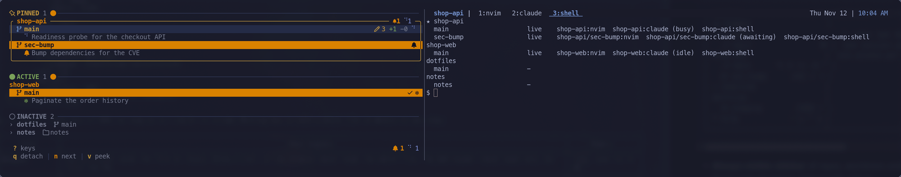
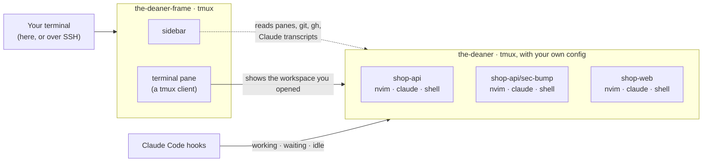

# the-deaner

<!-- Image goes here once there's one we're allowed to use (see "The name" below). -->

> ### *Just give'r.*
> Run a dozen coding agents across your repos without losing track of any of them.
> Shut it all down at night, bring it all back in the morning, and keep going.

the-deaner is a command center for running coding agents (Claude Code, codex, aider, anything)
side by side in the terminal. It's a sidebar that knows every repo, worktree and agent you have
going, next to a terminal that is just your own tmux. Linux first, macOS too.



## What it does

- **See every agent at once.** Each project lists its branches and worktrees, and under them every
  claude with what it's working on: its title from `/rename`, Claude's own title for the
  conversation, or your last prompt. Projects with several agents count them: `!1 ⠋2 ✻1`.
- **Know when you're needed.** An agent that's waiting on you, or finished while you were looking
  elsewhere, turns its row orange and stays orange until you go there. `n` takes you to the next
  one; press it again for the one after.
- **Look without switching.** `v` opens a popup with an agent's latest output; `q` closes it.
- **Repo first, worktree on demand.** Every repo gets a tmux session in its normal checkout. Need a
  second branch at the same time? `w` makes a worktree with its own session, next to the repo.
- **Any agent, any tool.** Tabs are tmux windows: claude, codex, aider, nvim, a dev server.
- **Git and GitHub at a glance.** Changed files, commits ahead and behind, the pull request and its
  CI status, for every branch (via `gh`).
- **Sections that stay put.** Pinned projects keep the order you gave them. The rest split into
  ACTIVE (an agent is running) and INACTIVE, which takes one line per project.
- **Done for the day.** `the-deaner shutdown` saves everything and stops it. Tomorrow, `the-deaner`
  offers to restore it all, and each claude picks up its own conversation. If the machine goes
  down without a shutdown, the autosave from the last five minutes is what comes back.
- **Take it with you.** Detach with `q`, SSH in from your laptop, run `the-deaner`, and you're looking
  at the same running setup.
- **Agents can talk to each other.** `the-deaner send shop-web:claude "…"` types into another agent's
  tab, so one claude can hand work to another.

## Install

You need **tmux 3.3 or newer** and **git**. **gh** (the GitHub CLI, logged in) is optional, for pull
request and CI status. A [Nerd Font](https://www.nerdfonts.com/) makes the icons look right; plain
Unicode icons are available too (`icons = "unicode"`).

**macOS (Apple Silicon):**

```sh
brew install sean-d/tap/the-deaner
```

**Arch, CachyOS, EndeavourOS, Omarchy:** grab the package from the
[latest release](https://github.com/sean-d/the-deaner/releases/latest) and install it with pacman:

```sh
sudo pacman -U the-deaner-*-x86_64.pkg.tar.zst
```

**Anywhere else, or from source** (needs a stable Rust toolchain):

```sh
cargo install --locked --git https://github.com/sean-d/the-deaner the-deaner
```

The first time you run it, the-deaner offers to add its status hooks to Claude Code
(`~/.claude/settings.json`, leaving your own hooks alone), so the sidebar can see what each claude is
doing. Say no and it won't ask again; `the-deaner install-hooks` adds them any time, and
`the-deaner install-hooks --uninstall` takes them out.

## First run

```sh
the-deaner add ~/dev/shop-api ~/dev/notes   # or browse for projects with `a` in the sidebar
the-deaner                                  # open the frame
```

Pick a project with `j`/`k` and press `Enter`. the-deaner starts a tmux session for it with your
default tabs (nvim, claude, a shell) and shows it on the right. `Alt-s` moves between the sidebar and
the terminal. In the terminal you're in plain tmux, with your own config and prefix.

Close the window whenever you like: everything keeps running, and `the-deaner` brings you back.

## Keys

In the sidebar:

| Key | Does |
|---|---|
| `j` / `k`, `g` / `G` | Move; jump to the top or bottom |
| `Ctrl-d` / `Ctrl-u` | Half a page down or up |
| `Enter` | Open the workspace in the terminal (starts or unparks it) |
| `n` | Go to the next agent that needs you |
| `v` | Peek at an agent's output |
| `t` | New tab: claude, nvim, a shell, anything you've configured |
| `w` | New worktree and session for a branch |
| `a` | Add a project: browse folders, favorites with `Ctrl-f` |
| `p`, `J` / `K` | Pin or unpin; move a pinned project up or down |
| `Space`, `/` | Collapse a project; filter by name or branch |
| `P`, `x` | Park a workspace (save and stop it); archive a worktree or forget a project |
| `q` | Detach. Everything keeps running |
| `?` | Every key, searchable, plus what the icons mean |

Anywhere: `Alt-s` sidebar ↔ terminal, `Alt-e` hide or show the sidebar, `Alt-/` the searchable
cheat sheet. These are tmux key names in `~/.config/the-deaner/config.toml`, so you can change them.

## What the icons mean

| | |
|---|---|
| `⠋` | An agent is working |
| `!` (a bell with a Nerd Font) | An agent is waiting on you: a question, a plan to approve, a permission |
| `✻` | An agent is idle |
| Orange row | Waiting on you, or finished while you were elsewhere. Clears when you go there |
| `‖` | Parked: saved and stopped; `Enter` brings it back |
| `✎ 3`, `+1 -2` | Changed files; commits ahead of and behind the upstream |
| `#42 ✓` | The branch's pull request and its CI: `✓` passing, `✗` failing, `…` running |
| `▲ 3 more` / `▼ 3 more` | Projects scrolled out of view; click to scroll |

## Working from somewhere else

the-deaner runs on its own tmux servers, so your window is only a view onto it. From another
machine:

```sh
ssh you@your-box
the-deaner          # the same running setup
```

Press `q` in the sidebar to detach before you disconnect, or just close the window. Nothing stops.

## How it works



Two tmux servers. The *frame* holds the sidebar and a terminal pane; the *workspaces* server holds one
session per workspace, with your own tmux config, and the terminal pane is a client attached to
whichever one you've opened. Claude Code hooks tag each agent's pane with its status, and the sidebar
reads that along with git, `gh` and Claude's transcripts. More in [architecture](docs/architecture.md).

## Documentation

[Getting started](docs/getting-started.md) ·
[Workflows](docs/workflows.md) ·
[Keybindings](docs/keybindings.md) ·
[Configuration](docs/configuration.md) ·
[Agents and hooks](docs/agents.md) ·
[CLI reference](docs/cli.md) ·
[Architecture](docs/architecture.md) ·
[Development](docs/development.md)

## The name

Named for Dean "Deaner" Murdoch of [*FUBAR*](https://en.wikipedia.org/wiki/FUBAR_(film)) (2002),
played by Paul Spence, whose answer to everything is *just give'r*: keep going. That's the job here.
the-deaner keeps your agents going so you can too. It's a tribute; the project has no connection to
the film or its makers.

## License

MIT
