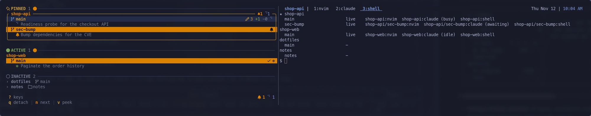
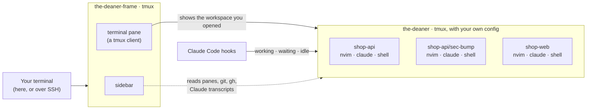

# the-deaner

<p align="center">
  
</p>

<p align="center">
  <b><i>Turn up the good, turn down the suck.</i></b><br>
  <b><i>Just give'r.</i></b>
</p>

Run a dozen coding agents across your repos without losing track of any of them. Shut it all down
at night, bring it all back in the morning, and keep going.

the-deaner is a command center for running coding agents (Claude Code, codex, aider, anything)
side by side in the terminal. It's a sidebar that knows every repo, worktree and agent you have
going, next to a terminal that is just your own tmux. Linux first, macOS too.



## What it does

- **See every agent at once.** Each project lists its branches and worktrees, and under them every
  claude with what you last asked it (or its name from `/rename`; `agent_line` switches to Claude's
  title for the conversation, or both). Projects with several agents count them: `!1 ⠋2 ✻1`.
- **Know when you're needed.** An agent that's waiting on you, or finished while you were looking
  elsewhere, turns its row orange and stays orange until you go there. `n` takes you to the next
  one; press it again for the one after.
- **Look without switching.** `v` opens a popup with an agent's latest output; `q` closes it. `o`
  opens Reports: every claude's latest answer in one place, kept current as they finish.
- **Repo first, worktree on demand.** Every repo gets a tmux session in its normal checkout. Need a
  second branch at the same time? `w` makes a worktree with its own session, next to the repo.
- **Any agent, any tool.** Tabs are tmux windows: claude, codex, aider, nvim, a dev server.
- **Git and GitHub at a glance.** Changed files, commits ahead and behind, the pull request and its
  CI status, for every branch (via `gh`).
- **Sections that stay put.** Pinned projects keep the order you gave them. The rest split into
  ACTIVE (an agent is running), ASLEEP (put to sleep with `z`, shown only when something is), and
  INACTIVE (open, nothing working). ASLEEP and INACTIVE take one line per project.
- **Done for the day.** `the-deaner shutdown` saves everything and stops it. Tomorrow, `the-deaner`
  offers to restore it all, and each claude picks up its own conversation. If the machine goes
  down without a shutdown, the autosave from the last five minutes is what comes back.
- **Stays current.** When a new release is out, the sidebar says so (`↑ 0.2.0 upgrade
  available`). `the-deaner upgrade` installs it with pacman or Homebrew and comes back on the new
  version, offering to restore everything, all in the same window.
- **Take it with you.** Detach with `q`, SSH in from your laptop, run `the-deaner`, and you're looking
  at the same running setup.
- **Agents can talk to each other.** `the-deaner send shop-web:claude "…"` types into another agent's
  tab, so one claude can hand work to another.

## Install

You need **tmux 3.3 or newer** and **git**. **gh** (the GitHub CLI, logged in) is optional, for pull
request and CI status. A [Nerd Font](https://www.nerdfonts.com/) makes the icons look right; plain
Unicode icons are available too (`icons = "unicode"`).

**macOS (Apple Silicon):**

```sh
brew install sean-d/tap/the-deaner
```

**Arch, CachyOS, EndeavourOS, Omarchy:** grab the package from the
[latest release](https://github.com/sean-d/the-deaner/releases/latest) and install it with pacman:

```sh
sudo pacman -U the-deaner-*-x86_64.pkg.tar.zst
```

**Anywhere else, or from source** (needs a stable Rust toolchain):

```sh
cargo install --locked --git https://github.com/sean-d/the-deaner the-deaner
```

After that, `the-deaner upgrade` keeps it up to date (see [Updating](#updating)).

The first time you run it, the-deaner offers to add its status hooks to Claude Code
(`~/.claude/settings.json`, leaving your own hooks alone), so the sidebar can see what each claude is
doing. Say no and it won't ask again; `the-deaner install-hooks` adds them any time, and
`the-deaner install-hooks --uninstall` takes them out.

## Updating

Once a day the sidebar asks GitHub whether there's a newer release. If there is, a line appears
above the footer until you install it:

```text
 ↑ 0.2.0 upgrade available
 ? keys
 a add | x remove | z sleep
 q detach | p pin | n next
 v0.1.9
```

Run `the-deaner upgrade`, from a the-deaner tab or any terminal:

```text
$ the-deaner upgrade
the-deaner 0.2.0 is out (you have 0.1.5): https://github.com/sean-d/the-deaner/releases/tag/v0.2.0
Install 0.2.0 and restart? [Y/n]
```

It installs the release the way you installed the-deaner: on Arch, the package from the release
(checksum checked) with `sudo pacman -U`; on macOS, `brew update` and `brew upgrade`. Then it saves
your workspaces, restarts in the same window, offers to restore them, says "Updated to the-deaner
0.2.0", and opens **What's new**: what changed since the version you had, then every earlier
version (also the guide's first page, and `the-deaner changelog`; [CHANGELOG.md](CHANGELOG.md) here).
Nothing is ever installed without you running it. `the-deaner upgrade --check`
only reports, and `update_check = false` in the config turns the daily check off. Installed a new
version some other way (`brew upgrade`, `pacman -U`)? The sidebar notices and switches to it by itself
within a few seconds. More in [getting started](docs/getting-started.md#updating).

## First run

```sh
the-deaner add ~/dev/shop-api ~/dev/notes   # or browse for projects with `a` in the sidebar
the-deaner                                  # open the frame
```

Pick a project with `j`/`k` and press `Enter`. the-deaner starts a tmux session for it with your
default tabs (nvim, claude, a shell) and shows it on the right. `Alt-s` moves between the sidebar and
the terminal. In the terminal you're in plain tmux, with your own config and prefix.

Close the window whenever you like: everything keeps running, and `the-deaner` brings you back.

## Keys

In the sidebar:

| Key | Does |
|---|---|
| `j` / `k`, `g` / `G` | Move; jump to the top or bottom |
| `Ctrl-d` / `Ctrl-u` | Half a page down or up |
| `Enter` | Open the workspace in the terminal (starts or wakes it) |
| `n` | Go to the next agent that needs you |
| `v` | Peek at an agent's output |
| `o` | Reports: every claude's latest answer, live |
| `t` | New tab: claude, nvim, a shell, anything you've configured |
| `w` | New worktree and session for a branch |
| `a` | Add a project: browse folders, favorites with `Ctrl-f` |
| `p`, `J` / `K` | Pin or unpin; move a pinned project up or down |
| `Space`, `/` | Collapse a project; filter by name or branch |
| `z` (or `P`), `x` | Put a workspace to sleep (save it, stop its tmux session; `Enter` wakes it); remove a worktree (then, if you like, its branch) or a project, stopping their tmux sessions |
| `q` | Detach. Everything keeps running |
| `?` | Every key, searchable, plus what the icons mean |

Anywhere: `Alt-s` sidebar ↔ terminal, `Alt-e` hide or show the sidebar, `Alt-/` the searchable
cheat sheet. These are tmux key names in `~/.config/the-deaner/config.toml`, so you can change them.

## What the icons mean

| | |
|---|---|
| `⠋` | An agent is working |
| `!` (a bell with a Nerd Font) | An agent is waiting on you: a question, a plan to approve, a permission |
| `✻` | An agent is idle |
| Orange row | Waiting on you, or finished while you were elsewhere. Clears when you go there |
| `‖` | Asleep (`z`): saved and stopped; `Enter` wakes it |
| `✎ 3`, `+1 -2` | Changed files; commits ahead of and behind the upstream |
| `#42 ✓` | The branch's pull request and its CI: `✓` passing, `✗` failing, `…` running |
| `▲ 3 more` / `▼ 3 more` | Projects scrolled out of view; click to scroll |
| `↑ 0.2.0` | A newer the-deaner is out; `the-deaner upgrade` installs it |

## Working from somewhere else

the-deaner runs on its own tmux servers, so your window is only a view onto it. From another
machine:

```sh
ssh you@your-box
the-deaner          # the same running setup, and your desk window lets go
```

The window you run `the-deaner` in takes over, so the screen you're using sets the size
(`the-deaner --shared` keeps the other window attached). Press `q` in
the sidebar to detach before you disconnect, or just close the window. Nothing stops.

## How it works



Two tmux servers. The *frame* holds the sidebar and a terminal pane; the *workspaces* server holds one
session per workspace, with your own tmux config, and the terminal pane is a client attached to
whichever one you've opened. Claude Code hooks tag each agent's pane with its status (without them,
the sidebar reads Claude's own session files instead), and the sidebar reads that along with git,
`gh` and Claude's transcripts. More in [architecture](docs/architecture.md).

## Documentation

[What's new](CHANGELOG.md) ·
[Getting started](docs/getting-started.md) ·
[Workflows](docs/workflows.md) ·
[Projects on every machine](docs/projects.md) ·
[Keybindings](docs/keybindings.md) ·
[Configuration](docs/configuration.md) ·
[Agents and hooks](docs/agents.md) ·
[CLI reference](docs/cli.md) ·
[Architecture](docs/architecture.md) ·
[Development](docs/development.md)

The same pages are built into the-deaner, for the version you're running: press `Alt-/` (or `?` in
the sidebar), then `Tab`, or run `the-deaner guide` (`the-deaner guide workflows` opens a page). They
read and search like a pager, diagrams included, and work over SSH too.

## The name

Named for Dean "Deaner" Murdoch of [*FUBAR*](https://en.wikipedia.org/wiki/FUBAR_(film)) (2002),
played by Paul Spence. Deaner lives by two mottos: *just give'r*, and this one.

**Turn up the good, turn down the suck.** Deaner treats life like a stereo: happiness and misery
are knobs, and you set them. Running agents the usual way has the suck knob cranked: a pile of
tmux panes, terminal tabs and windows, a claude somewhere waiting on you that you won't notice for
twenty minutes, and no idea which one finished. the-deaner turns that down: one sidebar, every
project and every agent, what each one is doing, and what needs you, in orange.

It's a tribute; the project has no connection to the film or its makers.

## License

MIT
