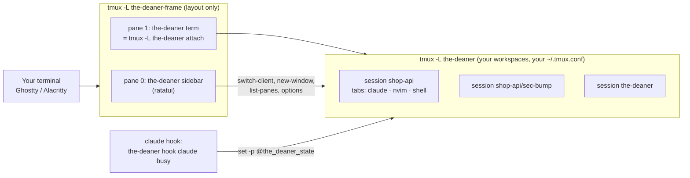
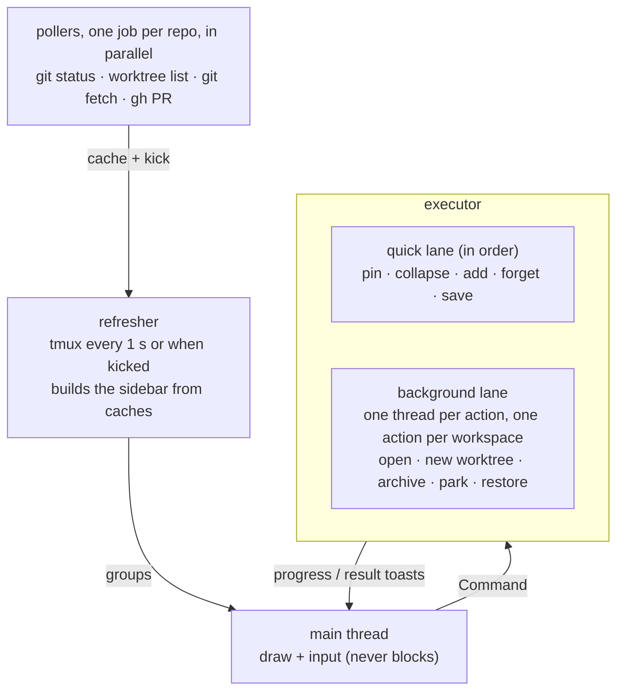

# Architecture

## Two tmux servers

- The **frame** server has a fixed two-pane layout, no prefix, and no status line. It binds only
  the focus and toggle keys plus mouse handling. Because the sidebar is one pane, one process
  serves every workspace, its width is a single setting, and hiding it is just zooming the
  terminal pane.
- The **workspace** server is ordinary tmux with your own config. Each workspace is a session,
  each tab a window. You can attach to it without the-deaner (`tmux -L the-deaner attach`).
- Opening a workspace from the sidebar runs `switch-client` on the terminal pane's tmux client.

## All state lives in tmux

the-deaner stores its metadata as tmux user options, so there is no daemon or database, and the sidebar
can restart at any time without losing anything:

| Option | Scope | Meaning |
|---|---|---|
| `@the_deaner_path` | session | Workspace directory (marks a session as the-deaner's) |
| `@the_deaner_repo` | session | Main repo root |
| `@the_deaner_branch` | session | Branch it was created for |
| `@the_deaner_worktree` | session | `1` for linked worktrees |
| `@the_deaner_state` | pane | Agent state from hooks |
| `@the_deaner_agent` | pane | Agent name |
| `@the_deaner_agent_session` | pane | Agent conversation id (for resume) |
| `@the_deaner_launch` | pane | Command the-deaner launched |

One `tmux list-panes -a -F …` call reads everything.

## Crates

The workspace is split so that edits rebuild as little as possible:

| Crate | What | Depends on |
|---|---|---|
| `the-deaner-core` | Model, config, state, parsers (git porcelain v2, worktree list, gh JSON, tmux formats), sidebar ordering, snapshot and restore rules, and the subprocess-with-deadline helper. No other IO. | serde, toml |
| `the-deaner-tmux` | Typed wrapper over the tmux CLI; `TestServer` for isolated test servers | core |
| `the-deaner-git` | Runs git and gh | core |
| `the-deaner-ui` | Sidebar state machine, keymap (source of truth for keys and docs), rendering | core, ratatui, ratcn |
| `the-deaner` | Engine (create, restore, park, archive), frame, hooks, CLI | all |

Editing sidebar code rebuilds `the-deaner-ui` and the binary. Editing a parser rebuilds everything
above `the-deaner-core`, which is still small.

## Sidebar threads: nothing waits on anything else

- **Every subprocess has a deadline**: tmux 5 s, git queries 10 s, `git worktree add/remove` and
  background `git fetch` 120 s, gh 20 s. A process that hangs is killed, and the error shows up as a toast or a stale
  badge, never a frozen sidebar.
- **Pollers** run each repo's git status, worktree list, fetch and PR check as separate jobs: one job
  per repo at a time, up to 8 git status, 4 fetch and 4 gh jobs in parallel. The refresher only reads their caches, so a
  huge or hung repo delays its own badge and nothing else. A failed or timed-out check keeps the
  last good value.
- **Executor**: quick state changes apply in order on one lane. Slow actions each get their own
  thread with a spinner toast. A second action on a workspace that is already busy is refused
  ("Still working on api") instead of queueing behind it. A restore runs alone. Writes to
  `state.toml` are serialized, so parallel actions never lose each other's updates.

`the-deaner-ui` never does IO. Keys become `Command` values, data arrives as `RepoGroup`s, and all of
it is tested with ratatui's `TestBackend` and insta snapshots.

## Restart and upgrade

`the-deaner` with no arguments starts the frame if needed and then waits on `tmux attach`. That
waiting process is what lets a restart bring the window back:

1. `the-deaner restart` saves a snapshot and writes the current time (ms) to
   `~/.local/state/the-deaner/restart`, then stops the frame and the workspace server.
2. Each waiting `the-deaner` sees its attach end. If the restart time is later than when it
   attached, it waits for both servers to be gone (so the new sidebar finds nothing running and
   offers to restore), then `exec`s the binary now on disk. A window you detached from or closed
   never comes back by itself, because there's no restart newer than its attach.
3. If no window is attached and the command isn't running inside a workspace tab, the command
   itself starts the-deaner in its own terminal.

On Linux, a binary replaced while it runs (as `pacman -U` does) reports its path as
`/usr/bin/the-deaner (deleted)`. the-deaner strips that suffix wherever it starts itself again (the
relaunch and the sidebar's popups), so it runs the new file at the same path. On macOS, Homebrew's
`/opt/homebrew/bin/the-deaner` is a symlink that moves to the new version.

The sidebar also watches its own binary: every 2 seconds it `stat`s the path it started from
(following Homebrew's symlink). When the file changes and then stays unchanged for 2 seconds, and the
new file's `--version` runs, the sidebar waits until no action is running and no prompt, picker or
filter is open, restores the terminal and `exec`s the new binary with the same arguments, in the same
pane. Everything it shows comes from tmux, so nothing is lost. A new binary that doesn't run is
ignored until it changes again.

`the-deaner upgrade` reads `repos/sean-d/the-deaner/releases/latest`, compares versions, and
recognizes the install from the binary's path: a path inside Homebrew's `Cellar`, or one that
`pacman -Qqo` says belongs to the `the-deaner` package. It installs, runs the new binary's
`--version` to make sure it changed, and only then restarts. The sidebar's daily check is one
thread that reads the cached answer in `update.toml` every 5 seconds and asks GitHub only when the
answer is a day old. `last_version` in `state.toml` is how the sidebar knows to say "Updated to …"
once.

## Snapshots and restore

A snapshot is TOML listing each workspace's windows (name, layout string) and panes (cwd, launch
command, agent, conversation id, whether something other than the login shell was in the
foreground). Restore rebuilds sessions, splits, layouts and active selections, then types into
each pane what `restore_command` decides:

1. Agent with a conversation that exists: its `resume` template, e.g. `claude --resume <id>`.
2. Any other agent: its command, started fresh. (Claude assigns an id at startup but only writes a
   conversation after the first message, so the-deaner checks for the transcript before resuming.)
3. A launched command that was still running: run it again.
4. A known editor that was running: reopen it.
5. Otherwise: a plain shell.
