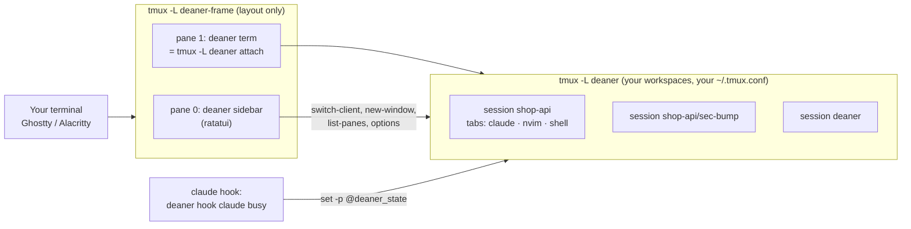
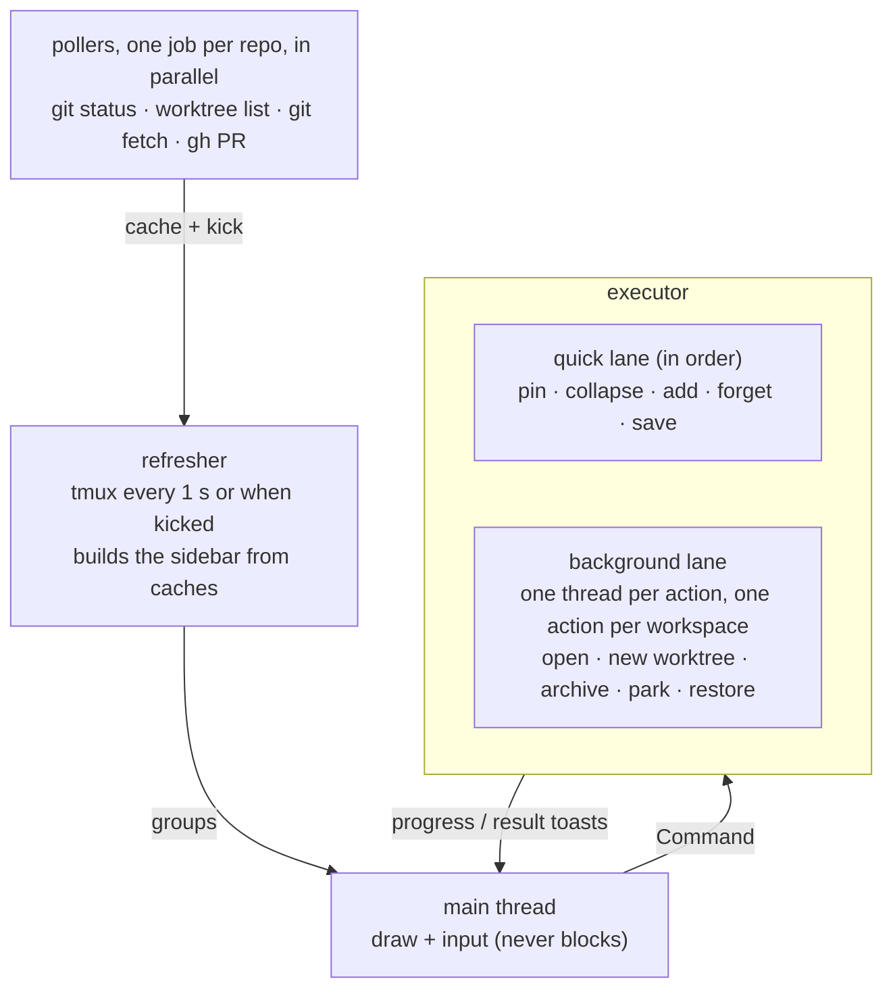

# Architecture

## Two tmux servers

- The **frame** server has a fixed two-pane layout, no prefix, and no status line. It binds only
  the focus and toggle keys plus mouse handling. Because the sidebar is one pane, one process
  serves every workspace, its width is a single setting, and hiding it is just zooming the
  terminal pane.
- The **workspace** server is ordinary tmux with your own config. Each workspace is a session,
  each tab a window. You can attach to it without deaner (`tmux -L deaner attach`).
- Opening a workspace from the sidebar runs `switch-client` on the terminal pane's tmux client.

## All state lives in tmux

deaner stores its metadata as tmux user options, so there is no daemon or database, and the sidebar
can restart at any time without losing anything:

| Option | Scope | Meaning |
|---|---|---|
| `@deaner_path` | session | Workspace directory (marks a session as deaner's) |
| `@deaner_repo` | session | Main repo root |
| `@deaner_branch` | session | Branch it was created for |
| `@deaner_worktree` | session | `1` for linked worktrees |
| `@deaner_state` | pane | Agent state from hooks |
| `@deaner_agent` | pane | Agent name |
| `@deaner_agent_session` | pane | Agent conversation id (for resume) |
| `@deaner_launch` | pane | Command deaner launched |

One `tmux list-panes -a -F …` call reads everything.

## Crates

The workspace is split so that edits rebuild as little as possible:

| Crate | What | Depends on |
|---|---|---|
| `deaner-core` | Model, config, state, parsers (git porcelain v2, worktree list, gh JSON, tmux formats), sidebar ordering, snapshot and restore rules, and the subprocess-with-deadline helper. No other IO. | serde, toml |
| `deaner-tmux` | Typed wrapper over the tmux CLI; `TestServer` for isolated test servers | core |
| `deaner-git` | Runs git and gh | core |
| `deaner-ui` | Sidebar state machine, keymap (source of truth for keys and docs), rendering | core, ratatui, ratcn |
| `deaner` | Engine (create, restore, park, archive), frame, hooks, CLI | all |

Editing sidebar code rebuilds `deaner-ui` and the binary. Editing a parser rebuilds everything
above `deaner-core`, which is still small.

## Sidebar threads: nothing waits on anything else

- **Every subprocess has a deadline**: tmux 5 s, git queries 10 s, `git worktree add/remove` and
  background `git fetch` 120 s, gh 20 s. A process that hangs is killed, and the error shows up as a toast or a stale
  badge, never a frozen sidebar.
- **Pollers** run each repo's git status, worktree list, fetch and PR check as separate jobs: one job
  per repo at a time, up to 8 git status, 4 fetch and 4 gh jobs in parallel. The refresher only reads their caches, so a
  huge or hung repo delays its own badge and nothing else. A failed or timed-out check keeps the
  last good value.
- **Executor**: quick state changes apply in order on one lane. Slow actions each get their own
  thread with a spinner toast. A second action on a workspace that is already busy is refused
  ("Still working on api") instead of queueing behind it. A restore runs alone. Writes to
  `state.toml` are serialized, so parallel actions never lose each other's updates.

`deaner-ui` never does IO. Keys become `Command` values, data arrives as `RepoGroup`s, and all of
it is tested with ratatui's `TestBackend` and insta snapshots.

## Snapshots and restore

A snapshot is TOML listing each workspace's windows (name, layout string) and panes (cwd, launch
command, agent, conversation id, whether something other than the login shell was in the
foreground). Restore rebuilds sessions, splits, layouts and active selections, then types into
each pane what `restore_command` decides:

1. Agent with a conversation id: its `resume` template, e.g. `claude --resume <id>`.
2. Agent without one: its command.
3. A launched command that was still running: run it again.
4. A known editor that was running: reopen it.
5. Otherwise: a plain shell.
